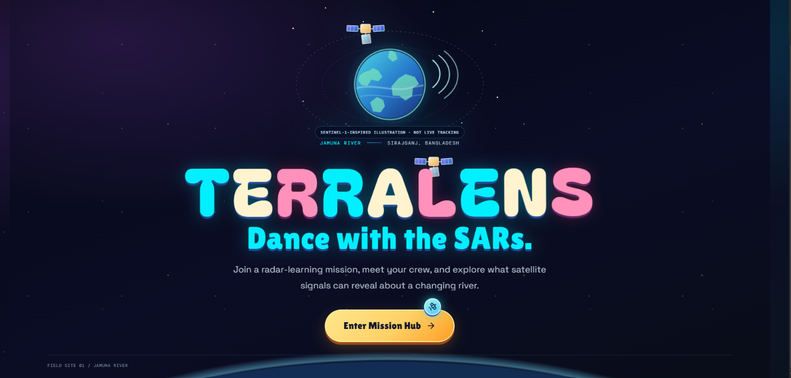
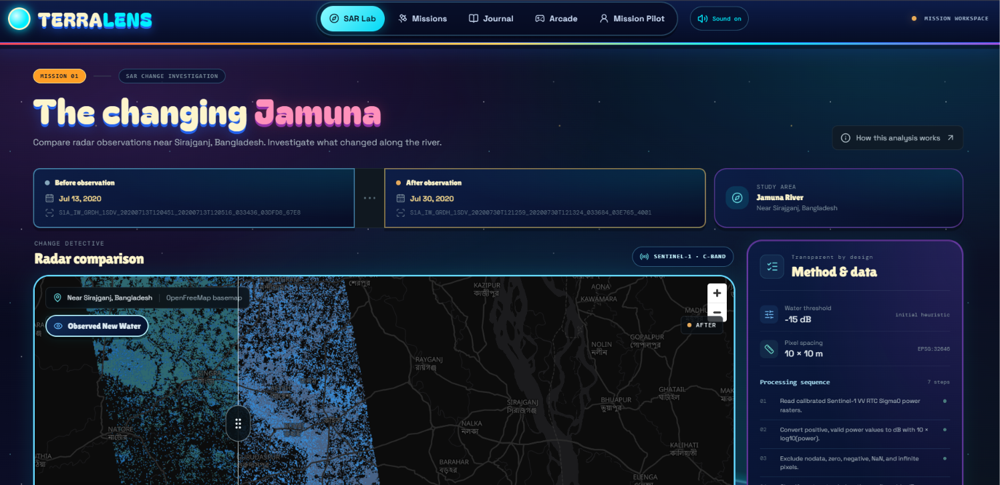
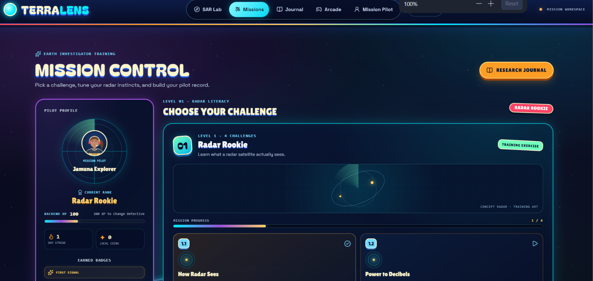
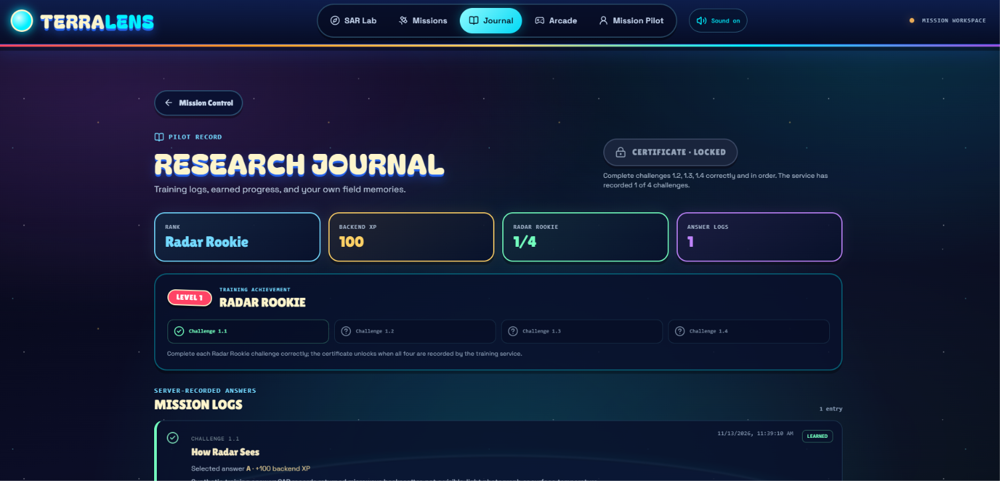
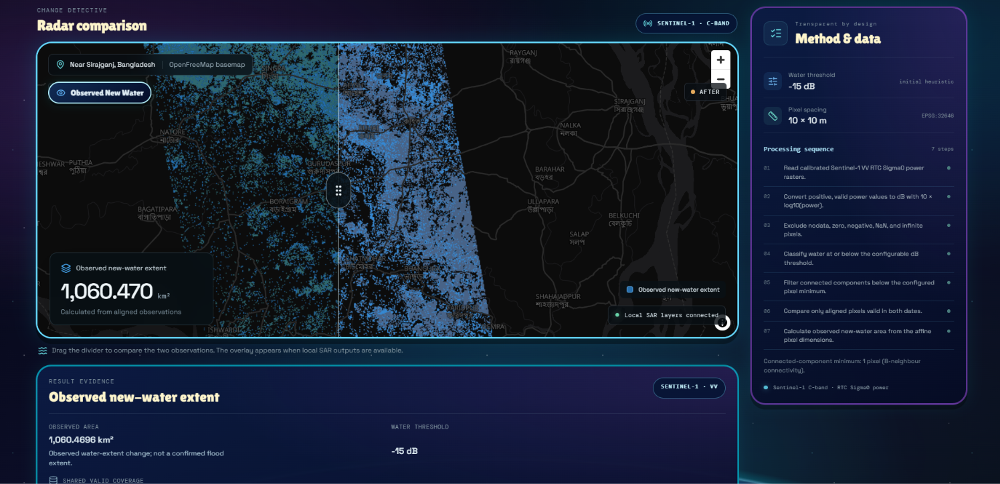
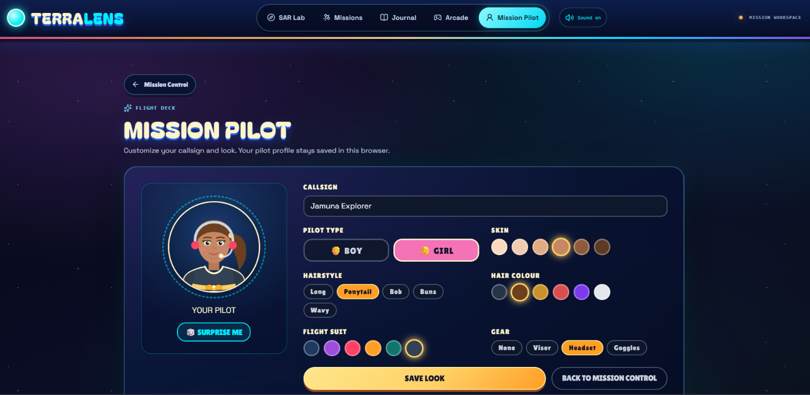
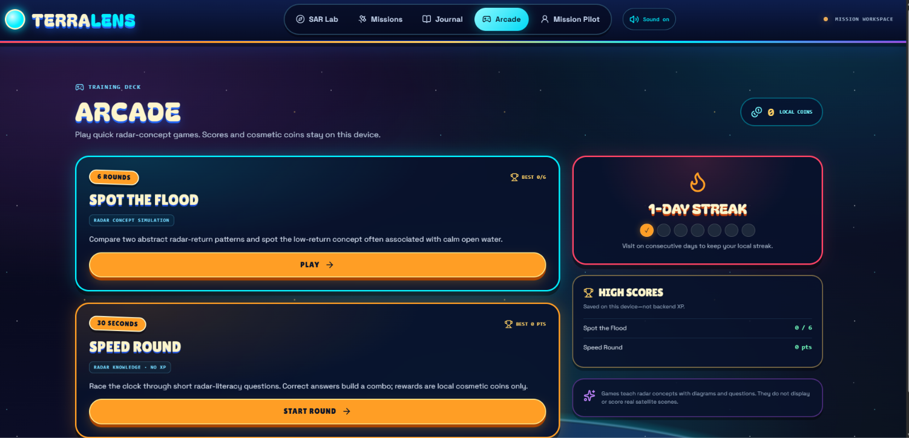
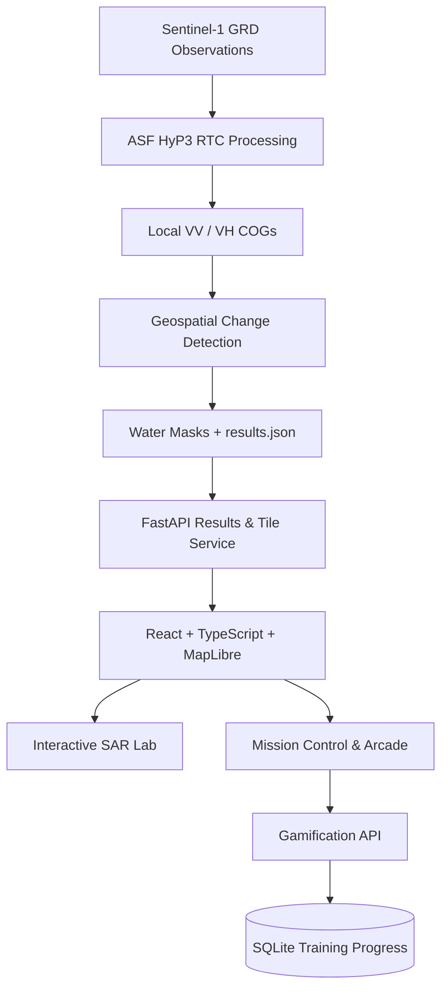

<div align="center">

# TERRALENS

### Earth observation, made explorable.

**A radar investigation lab where real Sentinel-1 processing meets playful, hands-on learning.**

<br/>

[](https://sentinels.copernicus.eu/web/sentinel/missions/sentinel-1)
[](src/)
[](src/api.py)
[](frontend/)
[](https://maplibre.org/)

<br/>



<br/>

**Explore Earth. Decode Radar. Discover Change.**

[Quick Start](#quick-start) ·
[SAR Lab](#the-sar-lab) ·
[Missions](#learn-through-play) ·
[Methodology](#scientific-methodology)

</div>

---

## What is TERRALENS?

TERRALENS is an interactive Earth-observation platform built around a real, reproducible **Sentinel-1 SAR workflow** for the Jamuna River near Sirajganj, Bangladesh.

It combines satellite radar processing, geospatial analysis, interactive visualization, and gamified learning into one exploration experience.

- **Investigate satellite observations.** Compare water masks derived from real Sentinel-1 acquisitions.
- **Explore spatial change.** Navigate synchronized before-and-after maps and inspect observed new-water regions.
- **Learn radar interactively.** Complete missions, earn XP, unlock challenges, and build your radar knowledge.
- **Track your journey.** Review training submissions, progression, and certificates in your Research Journal.

---

## Explore TERRALENS

<table>
<tr>
<td width="50%">

<h3>Welcome to TERRALENS</h3>
Enter an animated satellite-inspired experience with optional sound and a cosmic interface.
</td>
<td width="50%">

<h3>SAR Lab</h3>
Investigate real Sentinel-1-derived water masks through interactive map visualization.
</td>
</tr>
<tr>
<td width="50%">

<h3>Mission Control</h3>
Learn radar concepts through sequential challenges and interactive training.
</td>
<td width="50%">

<h3>Research Journal</h3>
Track your mission progress, review explanations, and unlock certificates.
</td>
</tr>
</table>

---

## The SAR Lab

Explore observed water extent changes across two Sentinel-1A observations of the Jamuna River region.

<div align="center">


*Interactive SAR exploration with before-and-after imagery and water-change overlays.*

</div>

### Study observations

| Observation | Acquisition date |
|---|---|
| Before | 13 July 2020 |
| After | 30 July 2020 |
| Time interval | 17 days |

**Before-scene**

```text
S1A_IW_GRDH_1SDV_20200713T120451_20200713T120516_033436_03DFD8_67E8
```

**After-scene**

```text
S1A_IW_GRDH_1SDV_20200730T121259_20200730T121324_033684_03E765_4001
```

### What the SAR Lab offers

- **Before & After:** Compare classified water masks from two satellite acquisitions.
- **Map exploration:** Explore spatial patterns through MapLibre.
- **New Water Overlay:** Toggle pixels classified as water in the later observation but not the earlier one.
- **Evidence Panel:** Inspect scene identifiers, acquisition dates, threshold, area, and shared valid coverage.
- **Scientific Context:** Understand the processing parameters behind the displayed results.

### Result layers

| Layer | Description |
|---|---|
| Before Water | Water classification from the earlier acquisition |
| After Water | Water classification from the later acquisition |
| New Water | Observed water-classification change within shared valid coverage |

<div align="center">



*Observed water extent change derived from Sentinel-1 VV backscatter.*

</div>

---

## Learn Through Play

TERRALENS turns radar learning into an interactive mission experience.

<table>
<tr>
<td align="center" width="33%">

### Mission Control


Sequential radar-learning challenges, answer feedback, and XP progression.

</td>
<td align="center" width="33%">

### Mission Pilot



Customize your pilot profile and explorer identity.

</td>
<td align="center" width="33%">

### Arcade



Play radar-learning activities and unlock cosmetic rewards.

</td>
</tr>
</table>

### Radar Rookie

The first training mission contains four exercises:

| Task | Progression |
|---|---|
| 1.1 | Initial challenge |
| 1.2 | Unlock after completing 1.1 |
| 1.3 | Unlock after completing 1.2 |
| 1.4 | Final challenge |

- Backend-graded answers.
- Sequential challenge unlocking.
- XP and rank progression.
- Recorded training submissions.
- Replay completed challenges for feedback.
- Radar Rookie certificate after genuine completion.

### Research Journal

<div align="center">


</div>

Your Research Journal keeps track of training submissions and progress.

- Review completed challenges.
- Read answer explanations.
- Track mission completion.
- Unlock and print the Radar Rookie certificate.

Mission completion and XP are recorded by the backend. Arcade scores, cosmetic coins, themes, and pilot profile information remain browser-local.

---

## Architecture

<div align="center">



</div>

### Technology stack

| Layer | Technologies |
|---|---|
| Satellite Processing | ASF HyP3, Sentinel-1 GRD RTC |
| Raster Analysis | Rasterio, GDAL, NumPy, SciPy |
| Backend | Python, FastAPI, Pydantic |
| Training Persistence | SQLite |
| Frontend | React, TypeScript, Vite |
| Visualization | MapLibre GL JS |
| Mapping | OpenFreeMap basemap |

---

## Quick Start

### Requirements

- Python 3.10+
- Node.js 20.19+ or 22.12+
- npm
- Internet connection for external map resources and ASF processing

### 1. Install Python dependencies

From the repository root:

```powershell
py -m venv .venv

.\.venv\Scripts\python.exe -m pip install -r requirements-data.txt
```

### 2. Start the backend

In Terminal 1, from the repository root:

```powershell
.\.venv\Scripts\python.exe -m uvicorn src.api:app --host 127.0.0.1 --port 8000 --reload
```

API documentation:

http://127.0.0.1:8000/docs

### 3. Start the frontend

In Terminal 2:

```powershell
cd frontend

npm ci

npm run dev
```

Open the local URL printed by Vite, usually:

http://localhost:5173

Mission Control and the training experience can be explored without prepared SAR outputs. The SAR Lab displays its processing status until local analysis results are available.

### Frontend API configuration

The frontend defaults to:

```text
http://127.0.0.1:8000
```

To configure the API origin, copy:

```powershell
Copy-Item .env.example .env.local
```

from `frontend/`, then configure `VITE_TERRALENS_API_URL` or the individual endpoint variables.

Vite environment variables are browser-visible. Never store credentials in frontend environment files.

---

## Sentinel-1 Data Workflow

TERRALENS prepares ASF HyP3 Sentinel-1 GRD RTC products using:

| Parameter | Value |
|---|---|
| Radiometry | Sigma0 |
| Scale | Linear power |
| Output spacing | 10 m |
| DEM | Copernicus DEM |
| Polarizations | VV and VH |

VV and VH products share a pixel grid within each scene. Different acquisitions can have different native CRSs, transforms, and extents.

### Prepare RTC COGs

The before-scene is fixed:

```text
S1A_IW_GRDH_1SDV_20200713T120451_20200713T120516_033436_03DFD8_67E8
```

Provide a later Sentinel-1 GRD scene identifier.

**Inspect job requests first:**

```powershell
.\.venv\Scripts\python.exe scripts\data\prepare_sar.py --after-scene <AFTER_SCENE_ID> --dry-run
```

**Submit RTC processing:**

```powershell
.\.venv\Scripts\python.exe scripts\data\prepare_sar.py --after-scene <AFTER_SCENE_ID> --auth token --confirm-submit
```

Live execution submits two HyP3 jobs and may consume processing credits.

Authentication options:

- `--auth token`: prompts for an Earthdata token without echoing or saving it.
- `--auth netrc`: uses locally configured `.netrc` credentials.

Never pass credentials as command-line arguments or commit them.

The preparation pipeline downloads the products, creates COGs when needed, validates VV/VH alignment, and records scene metadata.

### Run change detection

After preparation:

```powershell
.\.venv\Scripts\python.exe -m scripts.data.run_change_detection
```

Or explicitly configure the threshold and connected-component minimum:

```powershell
.\.venv\Scripts\python.exe -m scripts.data.run_change_detection --threshold-db -15 --min-component-pixels 1
```

Generated outputs:

```text
cache/outputs/
├── before_water.tif
├── after_water.tif
├── new_water.tif
└── results.json
```

### Geospatial comparison

The processing workflow:

1. Reads native scene grids from metadata.
2. Transforms geographic bounds into the comparison CRS.
3. Crops the before-scene grid to the overlap.
4. Reprojects after-scene linear Sigma0 power using nearest-neighbour sampling.
5. Restricts comparison to valid shared pixel centers.
6. Produces before-water, after-water, and new-water masks.
7. Records grid, coverage, parameters, and area in JSON.

Mask values:

| Value | Meaning |
|---|---|
| `1` | Classified water |
| `0` | Observed non-water |
| `255` | Nodata |

---

## Scientific Methodology

### Water classification

The detector converts valid positive VV Sigma0 power to decibels:

\[
\sigma^0_{dB}=10\log_{10}(\sigma^0_{power})
\]

Pixels at or below the configured threshold are classified as water.

The default threshold is **−15 dB**, an initial heuristic that can be adjusted using `--threshold-db`.

### Observed new-water change

\[
W_{new}=W_{after}\setminus W_{before}
\]

The classification is restricted to shared valid coverage.

The area is calculated from selected pixels and the affine pixel-area determinant in the projected metric CRS.

### Interpretation

TERRALENS visualizes **observed water extent change** between Sentinel-1 acquisitions.

The classification may be investigated alongside rainfall, river-gauge, optical, or field observations to understand possible flood-related changes.

A thresholded SAR difference alone does not establish flood causality or confirmed flood extent.

---

## API Reference

Interactive documentation:

http://127.0.0.1:8000/docs

| Method | Endpoint | Description |
|---|---|---|
| GET | `/api/health` | API health |
| GET | `/api/status` | SAR processing availability |
| GET | `/api/results` | Change-detection results |
| GET | `/tiles/{layer}/tiles.json` | TileJSON |
| GET | `/tiles/{layer}/{z}/{x}/{y}.png` | Raster PNG tile |
| GET | `/api/gamification/missions` | Mission content |
| GET | `/api/gamification/config` | Development configuration |
| POST | `/api/gamification/players/{player_id}/answers` | Submit training answer |
| GET | `/api/gamification/players/{player_id}/progress` | XP and progression |
| GET | `/api/gamification/players/{player_id}/journal` | Training journal |
| POST | `/api/gamification/players/{player_id}/reset` | Development-only player reset |

Available raster layers:

```text
before_water
after_water
new_water
```

The SAR endpoints read existing `cache/outputs/` files. Processing is performed separately by the data pipeline.

---

## Training Progression

Training progress is persisted in:

```text
cache/gamification.sqlite3
```

The browser generates an anonymous player UUID stored in local storage.

Backend records determine:

- Mission completion.
- Challenge unlocks.
- XP awards.
- Rank progression.
- Journal entries.
- Certificate eligibility.

Completed challenges can be replayed for feedback without awarding duplicate XP.

### Development-only reset

Reset is disabled by default.

Enable it for local development only:

```powershell
$env:TERRALENS_ENV = "development"
$env:TERRALENS_ENABLE_GAMIFICATION_RESET = "true"

.\.venv\Scripts\python.exe -m uvicorn src.api:app --host 127.0.0.1 --port 8000 --reload
```

The reset affects only the selected player's training records.

Keep the unauthenticated API bound to `127.0.0.1`.

---

## Development & Testing

### Run Python tests

From the repository root:

```powershell
.\.venv\Scripts\python.exe -m unittest discover -s tests
```

### Run preparation tests

```powershell
.\.venv\Scripts\python.exe -m unittest discover -s tests -p "test_prepare_sar.py"
```

### Build frontend

From `frontend/`:

```powershell
npm run build
```

### Validate Git changes

```powershell
git diff --check
git status --short
```

---


## Repository Structure

```text
.
├── src/
│   ├── api.py
│   ├── compute/
│   │   └── change.py
│   └── gamification/
│
├── scripts/
│   └── data/
│       ├── prepare_sar.py
│       └── run_change_detection.py
│
├── frontend/
│   ├── src/
│   │   ├── components/
│   │   └── gamification/
│   └── public/
│
├── tests/
│
├── docs/
│   └── images/
│       ├── welcome-screen.png
│       ├── sar-lab.png
│       ├── water-change.png
│       ├── mission-control.png
│       ├── mission-pilot.png
│       ├── arcade.png
│       └── research-journal.png
│
├── requirements-data.txt
└── README.md
```


---

## References

- [ASF Search](https://search.asf.alaska.edu/)
- [ASF HyP3 Python SDK](https://hyp3-docs.asf.alaska.edu/using/sdk/)
- [HyP3 SDK API Reference](https://hyp3-docs.asf.alaska.edu/using/sdk_api/)
- [HyP3 Authentication](https://hyp3-docs.asf.alaska.edu/using/authentication/)
- [Sentinel-1 RTC Product Guide](https://hyp3-docs.asf.alaska.edu/guides/rtc_product_guide/)
- [NASA Earthdata](https://www.earthdata.nasa.gov/)
- [MapLibre GL JS](https://maplibre.org/maplibre-gl-js/docs/)
- [Sentinel-1 Mission](https://sentinels.copernicus.eu/web/sentinel/missions/sentinel-1)

---

## Project Status

TERRALENS brings together real satellite observations, geospatial processing, interactive exploration, and radar-learning missions in one application.

The current implementation focuses on Sentinel-1 SAR analysis and the Jamuna River study area. The processing threshold remains an initial heuristic, and water extent changes are interpreted as observed satellite classifications.

No root `LICENSE` file is currently present.

---

<div align="center">

### Explore Earth. Decode Radar. Discover Change.

**TERRALENS — Your planet. Your mission.**

</div>
