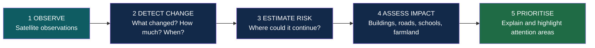
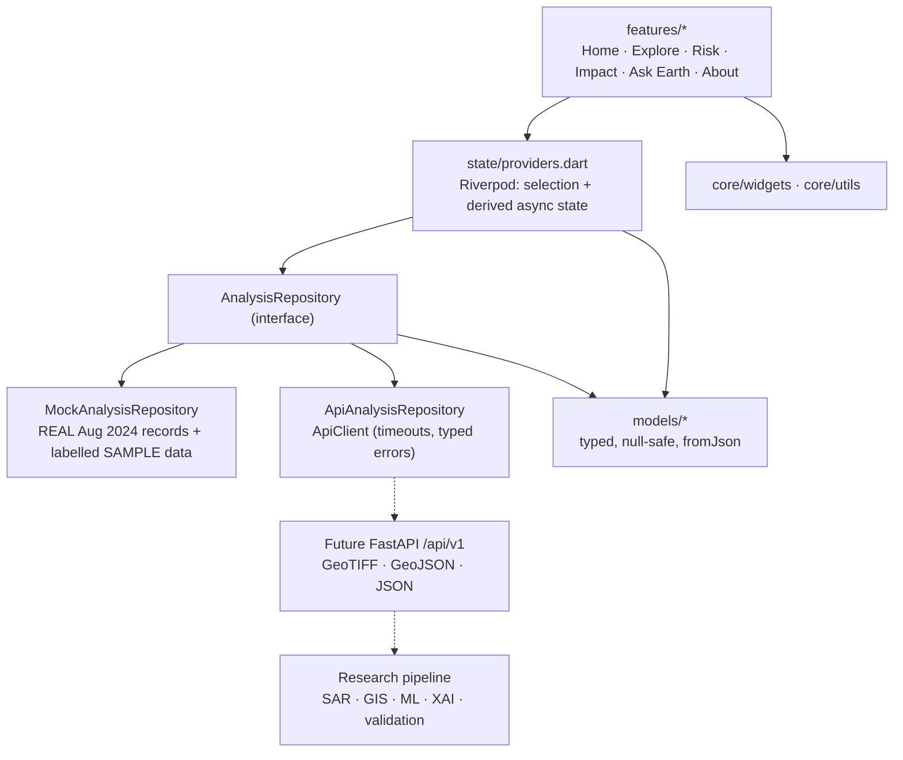
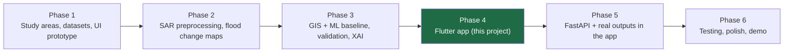

<div align="center">

# 🌍 EARTH RISK CHAIN

### From surface change to future risk

**A satellite-to-decision hazard intelligence app that shows what changed on Earth's surface, how reliable that finding is, and which people and assets may be exposed, without ever blurring observation, estimate and impact.**


-5FCB8A)


</div>

---

> ### 📌 Where is the code?
> This page is the project overview. **The complete Flutter source code (the `app/` folder, with all tests and documentation) is on the `tanisha-b1` branch** of this repository. See [Getting started](#8-getting-started) for the exact commands to fetch and run it.

---

## Table of contents <!-- omit in toc -->

1. [The problem](#1-the-problem)
2. [Our idea: the Earth Risk Chain](#2-our-idea-the-earth-risk-chain)
3. [Try it in two minutes (judge tour)](#3-try-it-in-two-minutes-judge-tour)
4. [Features](#4-features)
5. [What makes it different: scientific honesty by design](#5-what-makes-it-different-scientific-honesty-by-design)
6. [Real data: the August 2024 Bangladesh floods](#6-real-data-the-august-2024-bangladesh-floods)
7. [Architecture](#7-architecture)
8. [Getting started](#8-getting-started)
9. [Configuration](#9-configuration)
10. [Quality and testing](#10-quality-and-testing)
11. [Backend and research roadmap](#11-backend-and-research-roadmap)
12. [Limitations (stated openly)](#12-limitations-stated-openly)
13. [Project structure](#13-project-structure)
14. [Documentation](#14-documentation)
15. [Data sources and attribution](#15-data-sources-and-attribution)

---

## 1. The problem

Floods and landslides threaten millions of people in Bangladesh and across South Asia. Satellites such as Sentinel-1 and NISAR can see through cloud and monsoon rain, but the results rarely reach decision-makers in a form they can trust:

* **Maps without context.** A flood mask on its own does not say how much changed, since when, or how accurate it is.
* **Observation mistaken for prediction.** "The flooded area grew" is often read as "it will keep growing". Slope movement is read as "a landslide is coming".
* **Exposure mistaken for damage.** Assets inside a hazard zone are not the same as assets that were destroyed.
* **Missing data read as safety.** No satellite pass does not mean no flood.

## 2. Our idea: the Earth Risk Chain

One application, two hazard modules (**flood expansion** and **slope deformation / landslide monitoring**), built around a single, explicit chain of reasoning:



Every number in the app belongs to exactly one link of this chain and is labelled as such: **Observed**, **Derived**, **Predicted** or **Context**. A judge can understand the product in 30 seconds and still audit any figure back to its source.

## 3. Try it in two minutes (judge tour)

The app opens on clearly labelled sample data. Pick a **real** region from the region selector on Home.

| Step | Where | What to look at |
|---|---|---|
| 1 | **Home** → region selector → *Eastern Bangladesh (Aug 2024 floods)* | The green **REAL DATA** badge replaces the amber **SAMPLE DATA** badge. The flood card shows a measured **−8,700 km²** change reported by UNOSAT. |
| 2 | **Risk Analysis** | Observed change is shown on its own; the **future prediction panel is explicitly "Not available"**; validation says "Not evaluated – not a pass". Data-quality warnings come from the source agencies. |
| 3 | **Impact** | Noakhali, Cumilla and Feni show reported damage from the World Bank GRADE report, with a banner stating these are *reported damage counts, not modelled exposure*. Missing values read "Not available", never zero. |
| 4 | **Ask Earth** → *"What changed here?"* | A data-grounded answer composed from stored records (not an AI model), with its sources. Asked about safety, it refuses to judge. |
| 5 | Region selector → *Feni District (Aug 2024 flood)* | The real Sentinel-1 figure of **201 km²** (21 Aug 2024) and its six upazilas, ranked as priority areas. |
| 6 | Region selector → *Sylhet floodplain* (sample) → **Explore** | The full map experience: before/after/change comparison, observation timeline, layer toggles, legend and zone selection (clearly labelled sample overlays). |

## 4. Features

| Screen | Highlights |
|---|---|
| **Home · Earth Today** | Region selector, flood and slope summary cards, latest observation dates, observed-change summary, ranked priority areas, per-module data/prediction/validation status. |
| **Explore** | Interactive map (zoom, pan, recenter), observation **timeline**, **Before / After / Change** comparison, layer toggles with *why-unavailable* messages, legend, source attribution, zone markers and selection, offline schematic basemap fallback if tiles fail. |
| **Risk Analysis** | Flood: dates, before/after area, net change with expansion/contraction indicator, extent chart. Slope: line-of-sight displacement metrics and time-series chart. Separate prediction / susceptibility panel, validation, data quality, limitations and a **"Why this area?"** explanation with evidence and ranked factors. |
| **Impact** | Zone selection, observed-vs-predicted basis, exposure cards (buildings, roads, schools, agriculture, communities), category filters, zone-comparison chart, source / date / coverage notes. |
| **Ask Earth** | Chat interface with suggested questions, history, typing and error states. Answers are generated from local records and say *"not in the records"* when data is missing. |
| **About this data** | Explains data origin, status labels and the observed / derived / predicted / context separation. |

Also: responsive layout (bottom navigation on phones, navigation rail on desktop), Material 3 dark theme (navy · teal · white · restrained green), accessible contrast and semantic labels, consistent loading / error / empty / unavailable states.

## 5. What makes it different: scientific honesty by design

Most hazard dashboards optimise for impressive numbers. Earth Risk Chain optimises for **defensible** ones. These rules are enforced in the data models and the UI, not just written in a document:

| Principle | How the app enforces it |
|---|---|
| Observation ≠ prediction | Separate model fields, colours and chips for *Observed / Derived / Predicted / Context*. A future-expansion estimate lives in its own panel with an explicit **"Not available"** state. |
| Relative score ≠ probability | `PredictionKind` + `isCalibrated` flag; a relative class is labelled "not a probability" and "Uncalibrated". |
| Deformation ≠ landslide | Slope module keeps measured line-of-sight displacement and preliminary susceptibility in **separate** sections and layers. |
| Exposure ≠ damage | Impact copy always says "potentially exposed"; where a figure is *reported damage* it says so. |
| Unknown ≠ zero ≠ safe | Unknown values are `null` and render "Not available". Missing data is never presented as safety. |
| "Not evaluated" is not a pass | Validation status is a first-class state, never hidden. |
| No hidden calculations | Change statistics are **pre-computed fields** supplied by the research pipeline; the app never recomputes hazard values. |
| Real vs sample is always visible | **REAL DATA** (green) vs **SAMPLE DATA** (amber) badges, banners and per-record `isSample` flags. |
| Everything traceable | Each analysis lists data sources, processing version, quality flags and limitations. |

## 6. Real data: the August 2024 Bangladesh floods

Two regions use **verified historical records** bundled inside the app, so the figures work offline and are reproducible in a recorded demo (only the online basemap tiles need internet, and there is an offline schematic fallback). The original sample regions are kept for the features that need map geometry.

| Region | Real data included | Source |
|---|---|---|
| **Feni District (Aug 2024 flood)** | Sentinel-1 flood inundation on **21 Aug 2024**: **201 km²** district total; inundated area per upazila (Sonagazi 49, Chhagalnaiya 37, Fulgazi 35, Feni Sadar 33, Parshuram 31, Daganbhuiyan 16 km²). | Uddin et al. (2025), *J. Flood Risk Management* 18:e70087 · <https://doi.org/10.1111/jfr3.70087> |
| **Eastern Bangladesh (Aug 2024 floods)** | UNOSAT Sentinel-1 analysis: floodwaters receded by about **8,700 km²** between the 18–26 Aug and 28 Aug–4 Sep composites; about 8,100 km² flooded and about 6.2 million people exposed within the ~140,000 km² analysed. | UNOSAT FL20240825BGD via HDX (CC BY-SA) · <https://geo.btaa.org/catalog/007de930-02e7-4b32-8a6c-774c86eb2c8f> |
| | District impacts for **Noakhali, Cumilla, Feni**: affected population, damaged structures, damaged roads (km), damaged education institutes, deaths, estimated direct damage; FAO satellite estimate of ~2 million ha flooded cropland. | World Bank GRADE report (7 Oct 2024) · <https://documents1.worldbank.org/curated/en/099921506192542727/pdf/IDU-3c0e1de6-9af6-40b9-99a3-78397d1041ac.pdf> |

**What we deliberately did not do:** invent flood polygons, boundaries or per-date values. Where a source gives only a month (Feni 2022 and 2023 values) or no area statistic (NASA ARIA water maps for 9 and 21 Aug), the figure is not entered as a dated observation. Real regions therefore show *no map overlays* and *no predictions*; the app says so instead of faking them. Full provenance, verification notes and exclusions are documented in `app/docs/real_data_aug2024.md` on the code branch.

## 7. Architecture

A clean, layered, feature-first Flutter application designed so the research pipeline and FastAPI backend can plug in **without rewriting a single screen**.



* **One switch** (`analysisRepositoryProvider`, controlled by `--dart-define`) chooses bundled data or the backend. Screens never change.
* **Typed errors** (`NetworkException`, `RequestTimeoutException`, `ParseException`, …) become consistent loading / error / retry states.
* **Pure, testable map logic**: `buildOverlays()` decides which features to draw for the selected dates and compare mode.
* **Data-driven styling**: legend entries and GeoJSON style keys drive map colours, ready for real backend layers.

**Tech stack:** Flutter · Dart (null safety) · Material 3 · `flutter_riverpod` · `go_router` · `flutter_map` + `latlong2` · `fl_chart` · `http`. No code generation, no unnecessary dependencies.

## 8. Getting started

The source code is on the **`YOUR-BRANCH-NAME`** branch (this `main` branch holds only this overview).

**Prerequisites:** Flutter SDK 3.22+ (Dart 3.4+), Git. For Web: Chrome. For Android: Android Studio and an emulator or device. Check with `flutter doctor`.

```bash
git clone -b YOUR-BRANCH-NAME https://github.com/tanisha1402/Orielle.git
cd Orielle/app                 # the folder containing pubspec.yaml
flutter pub get
flutter run -d chrome          # or: flutter run   (Android device/emulator)
```

If the `android/` and `web/` folders are missing, generate them once with the bootstrap script included in `app/tool/`:

```powershell
# Windows PowerShell
.\tool\bootstrap.ps1
```
```bash
# macOS / Linux
sh tool/bootstrap.sh
```

No backend and no API key are required. The app starts offline on the bundled records.

**Release builds**

```bash
flutter build web --release          # build/web
flutter build apk --release          # build/app/outputs/flutter-apk/app-release.apk
```

## 9. Configuration

Everything is set at build time with `--dart-define`; no secrets live in the source code.

| Flag | Default | Purpose |
|---|---|---|
| `ERC_USE_MOCK` | `true` | `true` = bundled records (offline). `false` = use the FastAPI backend. |
| `ERC_API_BASE_URL` | *(empty)* | Backend URL, e.g. `http://10.0.2.2:8000` from an Android emulator. |
| `ERC_TILE_URL` | OpenStreetMap | XYZ tile template for the basemap. |
| `ERC_TILE_ATTRIBUTION` | `OpenStreetMap contributors` | Attribution shown on the map. |
| `ERC_TILE_USER_AGENT` | `org.earthriskchain.frontend` | Identifies the app to the tile server. |

```bash
flutter run -d chrome --dart-define=ERC_USE_MOCK=false --dart-define=ERC_API_BASE_URL=http://localhost:8000
```

The default public OpenStreetMap server is for development and demos only; use a provider whose terms allow production traffic. If tiles cannot load, the app offers an **offline schematic basemap** and all overlays keep working.

## 10. Quality and testing

```bash
dart format .
flutter analyze
flutter test
```

The code branch ships with automated tests covering:

| Suite | What it checks |
|---|---|
| `models_parsing_test` | JSON parsing, the roadmap's minimal schema, GeoJSON layers, unknown values staying `null`. |
| `mock_repository_test` | Deterministic data, internal consistency of statistics, every state (observed / predicted / unavailable) represented, the local Ask engine's honest answers. |
| `real_aug2024_data_test` | Each real figure pinned to its source (e.g. Feni upazilas sum to 201 km²), no invented geometry, no illustrative flags on real counts. |
| `api_repository_test` | HTTP repository against a fake client: endpoints, parsing, 404 / 500 / timeout / invalid JSON / no-URL error mapping. |
| `utils_and_overlays_test` | Formatters, geometry helpers, map overlay rules for Before / After / Change. |
| `widget_test` | Navigation across all five screens, responsive layouts, error and unavailable states, real-vs-sample labelling. |

The app has been run on Flutter Web (Chrome). Run the commands above on your machine to reproduce analysis and test results.

## 11. Backend and research roadmap

The frontend is the first deliverable of a three-track plan (Research → App → Integration). The contract is already defined, so the teams can work in parallel.



**Planned endpoints** (typed models and an HTTP repository already exist; the full request/response contract is in `app/docs/api_contract.md` on the code branch):

`GET /api/v1/health` · `/areas` · `/analyses?hazard=…` · `/analyses/{id}` · `/analyses/{id}/layers` · `/validation` · `/explanation` · `/impact` · `POST /api/v1/ask`

Raster outputs (GeoTIFF) are served as files or map tiles, never embedded in JSON. Heavy SAR processing and model training stay in the pipeline; the app only displays validated, date-stamped, source-attributed results.

## 12. Limitations (stated openly)

Credibility matters more than polish, so:

* Real regions have **no map overlays**: verified flood-extent geometry is not bundled. Overlays, infrastructure markers, predictions, susceptibility, validation metrics and slope deformation remain **labelled sample data**.
* Feni has a single dated Sentinel-1 scene, so no change between dates is measured there; the Eastern Bangladesh change (−8,700 km²) is a UNOSAT-reported value whose period totals are not published separately.
* District impact figures are **reported damage counts** (government data cited by the World Bank), not modelled exposure, and the source itself notes that satellite data did not capture the full flood extent.
* Raster / tile layers from a backend are listed but not yet drawn; only inline vector features render. Before/After is a toggle, not a swipe slider.
* The HTTP repository follows the written contract and is unit-tested against a fake client, but it has not been run against a live backend because the backend is not built yet.
* **Ask Earth is a transparent rule-based demo over stored records, not an AI model.**
* Alerts, the *Earth Mission* learning mini-game and additional hazards are intentionally left for later.

## 13. Project structure

Layout of the `app/` folder on the code branch:

```
app/
├── lib/
│   ├── main.dart                    entry point (ProviderScope)
│   ├── app/                         app widget, router, responsive shell, theme
│   ├── core/
│   │   ├── constants/               build-time config (--dart-define), tile provider
│   │   ├── errors/                  typed exceptions
│   │   ├── utils/                   formatters, JSON helpers, geometry, UI extensions
│   │   └── widgets/                 chips, cards, loading / error / unavailable panels
│   ├── models/                      typed domain models (analysis, layers, zones, impact …)
│   ├── data/
│   │   ├── mock/                    real Aug 2024 records + labelled sample dataset + Ask engine
│   │   ├── repositories/            repository interface, mock and HTTP implementations
│   │   └── services/                ApiClient (timeouts, typed errors)
│   ├── state/providers.dart         dependency injection, selection, derived async state
│   └── features/                    home · explore · risk_analysis · impact · ask_earth · about · common
├── test/                            unit, repository, API-client, overlay and widget tests
├── docs/                            architecture · API contract · real-data provenance · integration guide
└── tool/                            platform bootstrap scripts
```

## 14. Documentation

Detailed documents are in `app/docs/` on the code branch:

| Document | Contents |
|---|---|
| `architecture.md` | Layers, data flow, navigation, map rules, integrity rules. |
| `api_contract.md` | Endpoint-by-endpoint request / response formats for the backend team. |
| `real_data_aug2024.md` | Every real value, its source, how it was verified, and what was excluded. |
| `integration_guide.md` | How to merge the frontend into an existing repository safely. |

## 15. Data sources and attribution

* **Uddin, K. et al. (2025).** Rapid Flood Inundation Mapping for Effective Management… Feni District, Bangladesh. *Journal of Flood Risk Management* 18:e70087. <https://doi.org/10.1111/jfr3.70087>
* **UNOSAT (2024).** Satellite detected water extents between 28 August & 4 September 2024 in Bangladesh (FL20240825BGD). Humanitarian Data Exchange, CC BY-SA.
* **World Bank (2024).** Global RApid post-disaster Damage Estimation (GRADE) report, floods in eastern Bangladesh, August 2024. District data compiled from Bangladesh MoDMR / DDM; cropland estimate from FAO DIEM.
* **Zone reference points:** Wikipedia and Banglapedia administrative reference points (positions only, not boundaries).
* **Basemap:** © OpenStreetMap contributors (default; configurable).
* Satellite data context: Copernicus Sentinel-1 (ESA). NISAR products are the target for the future research pipeline.

---

<div align="center">

**EARTH RISK CHAIN** transforms satellite-observed surface changes into understandable hazard assessments, helping people see what is changing, where risk may develop, and what could be affected.

</div>
