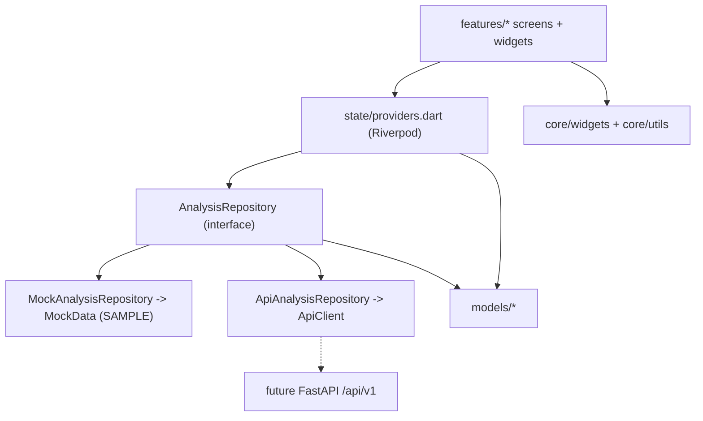

# EARTH RISK CHAIN - Flutter frontend (MVP, sample data)

*From surface change to future risk.* A geospatial hazard-monitoring app
frontend with two modules: **flood expansion** and **slope deformation /
preliminary landslide susceptibility**.

> ## Read this first: verification status
> This package was produced in an environment **without the Flutter/Dart SDK
> and without access to pub.dev**. Therefore:
>
> | Check | Done? |
> |---|---|
> | Dart syntax parse of all 59 `.dart` files (tree-sitter grammar) | Yes, 0 errors |
> | All relative/package imports resolve to existing files | Yes |
> | Heuristic scan for unused imports / missing `Class.member` | Yes (only false positives left) |
> | `flutter pub get` | **No** |
> | `dart format` | **No** |
> | `flutter analyze` | **No** |
> | `flutter test` | **No** (tests are written, never executed) |
> | `flutter build` / running on a device | **No** |
> | Screenshots | **Not generated** |
>
> Expect that your first `flutter analyze` / `flutter test` run may report a
> few small issues (type errors, API differences between package versions,
> layout overflows in tests). Section 18 explains how to triage them. Please
> run the commands in section 11 and fix or report what appears; nothing in
> this README claims they pass.

## 1. Project overview and current scope

**In scope (this package):** the complete Flutter frontend: five screens,
responsive navigation, an interactive map, charts, a deterministic **SAMPLE**
dataset, a repository abstraction and an HTTP repository prepared for the
future FastAPI backend, tests and documentation.

**Out of scope (not implemented):** Python research pipeline, FastAPI backend,
authentication, database, model training, real predictions, real satellite
data. The app runs offline on clearly labelled sample data.

**Core rule from the roadmap:** do not present placeholder figures as real
observations or model outputs. Every sample figure is labelled **SAMPLE DATA**;
observed change, estimates and exposure are kept separate.

## 2. Features

| Screen | What it does |
|---|---|
| **Home - Earth Today** | Branding, region selector, flood + slope cards (latest observation date, headline measurement, status), observed-change summary, priority areas, data-availability panel, **Open Explore** button. |
| **Explore** | Interactive map (zoom/pan, recenter), region + hazard selectors, observation timeline (range slider), Before / After / Change comparison, layer toggles (unavailable layers disabled with reason), legend, zone selection (markers, chips, map tap), sources/attribution, offline schematic basemap fallback. |
| **Risk Analysis** | Flood: dates, before/after areas, net change, expansion/contraction indicator, bar chart. Slope: LOS displacement metrics + time-series chart. Separate prediction/susceptibility panel (with an explicit *unavailable* state), validation, data quality & limitations, "Why this area?" with evidence and ranked factors. |
| **Impact** | Zone selector, observed vs predicted basis, exposure cards for buildings / roads / schools / agriculture / communities, category filters, zone-comparison chart, data source/date/coverage notes, "potentially exposed is not damaged". |
| **Ask Earth** | Chat UI, suggested questions, history, loading/typing state, error and "not in the records" states, demo answers from local sample records. **Not an AI model**; no API key. |
| **About this data** | Explains sample data, statuses and the observed/derived/predicted/context separation (has a back button). |

**Real data:** two extra regions, *Feni District (Aug 2024 flood)* and
*Eastern Bangladesh (Aug 2024 floods)*, use verified historical records for the
August 2024 floods (marked **REAL DATA**). Sources, values and what was
deliberately left out: [`docs/real_data_aug2024.md`](docs/real_data_aug2024.md).

Sample regions: three flood areas (expansion with no prediction; expansion
then partial recession with a preliminary estimate; no data at all) and one
hill-slope area. Switch regions/hazards to see every state.

Screenshots: none were generated (no device/emulator was available). Run the
app and capture your own for the competition deck.

## 3. Technology stack

Flutter (Dart null safety, Material 3, dark theme) - `flutter_riverpod`
(state + DI) - `go_router` (navigation) - `flutter_map` + `latlong2` (map) -
`fl_chart` (charts) - `http` (API client). No code generation, no
`intl`, no other dependencies. Versions are caret ranges in `pubspec.yaml`
(`flutter_riverpod ^2.5.1`, `go_router ^14.2.0`, `flutter_map ^7.0.2`,
`fl_chart ^0.69.0`, `http ^1.2.2`) chosen so that major-version API changes
(e.g. flutter_map 8, riverpod 3, fl_chart 1.x) are **not** pulled in
automatically.

Platforms: written for Android and Flutter Web. Desktop/iOS should work but
are untested; none of the platforms has been run.

## 4. Architecture



Screens render; providers hold state; repositories fetch; services do HTTP;
models are typed data. Details: [`docs/architecture.md`](docs/architecture.md).

## 5. Folder-by-folder

```
earth_risk_chain/
  README.md, pubspec.yaml, analysis_options.yaml, .gitignore
  assets/demo/              data notice (declared in pubspec); images/ icons/ placeholders
  docs/                     architecture.md, api_contract.md, integration_guide.md
  tool/                     bootstrap.sh / bootstrap.ps1 (create android/web folders)
  test/                     unit, repository, API-client, overlay and widget tests
  lib/
    main.dart               ProviderScope + app
    app/                    app.dart, router.dart, app_shell.dart, theme/
    core/
      constants/            app_config.dart  (--dart-define config, tile provider)
      errors/               typed exceptions
      utils/                formatters, json, colour, geo helpers, UI extensions
      widgets/              badges (chips), panels (cards, loading/error/unavailable)
    models/                 study_area, observation, analysis_result, map_layer,
                            hazard_zone, validation_result, explanation_result,
                            impact_summary, chat_message, data_status, hazard_type
    data/
      mock/                 mock_data.dart (SAMPLE dataset), mock_ask_engine.dart
      repositories/         analysis_repository (interface), mock_, api_analysis_repository
      services/             api_client.dart (HTTP transport)
    state/providers.dart    DI switch, selection, derived async providers
    features/
      common/               area picker, hazard selector, analysis gate, timeline selector
      home/ explore/ risk_analysis/ impact/ ask_earth/ about/
```

`android/` and `web/` are **not** in the ZIP: they are generated by
`flutter create` (section 9 / `tool/bootstrap.*`).

## 6. Prerequisites

* **Flutter SDK >= 3.22** (Dart >= 3.4), stable channel:
  <https://docs.flutter.dev/get-started/install>
* **Git**.
* For Android: Android Studio + SDK + an emulator or USB-debugging device.
* For Web: Google Chrome.
* **Windows:** use PowerShell; enable *Developer Mode* if Flutter asks.
  **macOS/Linux:** a normal terminal; Linux also needs `unzip`.

## 7. Verify your installation

```
flutter --version
dart --version
flutter doctor
```
`flutter doctor` should show a tick next to Flutter and at least one of
Chrome / Android toolchain. Fix what it reports before continuing.

## 8. Extract the ZIP

Windows PowerShell:
```powershell
Expand-Archive -Path .\earth_risk_chain_frontend.zip -DestinationPath .\erc-extracted
cd .\erc-extracted\earth_risk_chain
```
macOS / Linux:
```bash
unzip earth_risk_chain_frontend.zip -d erc-extracted
cd erc-extracted/earth_risk_chain
```

## 9. Install dependencies and create platform folders

Easiest (creates `android/` + `web/`, adds the Android INTERNET permission,
runs `pub get`):

```powershell
# Windows PowerShell (if scripts are blocked: Set-ExecutionPolicy -Scope Process Bypass)
.\tool\bootstrap.ps1
```
```bash
# macOS / Linux
sh tool/bootstrap.sh
```

Manual equivalent:
```
flutter create . --platforms=android,web --project-name earth_risk_chain
flutter pub get
```
and add `<uses-permission android:name="android.permission.INTERNET"/>` inside
`<manifest>` of `android/app/src/main/AndroidManifest.xml` (release builds need
it for map tiles). `flutter create` does not overwrite files that already
exist; check with `git diff` if you run it inside a repository.

## 10. Run the app

```
flutter run -d chrome          # web
flutter run                    # connected Android device/emulator
flutter devices                # list targets
```
No backend and no key are needed. The first screen shows **SAMPLE DATA** chips.

## 11. Tests and static analysis

```
dart format .
flutter analyze
flutter test
```
Test files: `models_parsing_test`, `mock_repository_test` (incl. the Ask
engine), `api_repository_test` (fake HTTP client), `utils_and_overlays_test`,
`widget_test` (navigation, all five screens, error/unavailable states,
responsive layout). Widget tests use a zero-latency repository and the
schematic basemap, so they need no network.

`analysis_options.yaml` relaxes two cosmetic lints
(`prefer_const_constructors`, `prefer_const_literals_to_create_immutables`)
because the code was written without analyzer access. To tidy later: delete
those two lines and run `dart fix --apply`.

## 12. Build

```
flutter build web --release            # output: build/web
flutter build apk --release            # output: build/app/outputs/flutter-apk/app-release.apk
```
If you deploy the web build under a sub-path add
`--base-href /your/path/`. Nothing has been built yet; see section 18 for
common failures.

## 13. Map tiles and attribution

Configured at build time, no secrets in code (`lib/core/constants/app_config.dart`):

| `--dart-define` | Default | Purpose |
|---|---|---|
| `ERC_TILE_URL` | `https://tile.openstreetmap.org/{z}/{x}/{y}.png` | XYZ tile template |
| `ERC_TILE_ATTRIBUTION` | `OpenStreetMap contributors` | shown on the map (the (c) sign is added by the widget) |
| `ERC_TILE_USER_AGENT` | `org.earthriskchain.frontend` | identifies the app to the tile server |

Example:
```
flutter run -d chrome --dart-define=ERC_TILE_URL=https://tiles.example.com/{z}/{x}/{y}.png --dart-define=ERC_TILE_ATTRIBUTION="Example Maps"
```
The default public OpenStreetMap server is for development and light demo use
only ([usage policy](https://operations.osmfoundation.org/policies/tiles/)).
For production, use a provider whose terms allow it and change the user-agent
to your real app id. If an API key is required, supply it through the URL
template at build time; **never commit it**.

If tiles do not load (offline, blocked network) a banner offers the **offline
schematic basemap**; you can also toggle it with the grid icon on the map. All
overlays keep working. Overlays are sample geometry and are labelled so.

## 14. How mock data works and where to edit it

`lib/data/mock/mock_data.dart` holds the whole dataset: study areas, four
analyses (observations, change statistics for every date pair, zones, layers,
validation, explanation, impact) and the geometry generator. It is
deterministic (no randomness, no clock). Every record has an id, hazard,
area id, dates, source label, status, prediction/validation status and
limitations. Unknown values are `null`.

Edit points:
* change numbers/dates: the `_flood001()`, `_flood002()`, `_slope001()` builders;
* add an area: extend `MockData.areas` and add an analysis to `MockData.bundles`;
* geometry is generated by `_blob(...)` from the sample areas (roughly
  proportional, schematic).

`MockAnalysisRepository` adds a 250 ms delay so loading states are visible
(`MockAnalysisRepository(latency: Duration.zero)` removes it).

## 15. Extending the app

* **New screen:** create `lib/features/<name>/<name>_screen.dart`, add a
  `GoRoute` (or a branch in `router.dart`), and read data through providers.
* **New model:** add `lib/models/<name>.dart` with a `fromJson` using
  `core/utils/json_utils.dart`, add a method to `AnalysisRepository`, implement
  it in both repositories, add a `FutureProvider` in `state/providers.dart`.
* **New reusable widget:** put it in `lib/core/widgets` if it is generic
  (no providers), otherwise `lib/features/common`.
* Handle loading/error with `AsyncValueView` and "no analysis" with
  `AnalysisGate`.

## 16. Switch from mock to FastAPI

```
flutter run -d chrome --dart-define=ERC_USE_MOCK=false --dart-define=ERC_API_BASE_URL=http://localhost:8000
```
* Android emulator reaching a backend on your computer: `http://10.0.2.2:8000`.
* Physical device: your computer's LAN IP; the backend must listen on `0.0.0.0`.
* Flutter Web: the backend must allow CORS for the app's origin.
* Android release builds to a plain `http://` URL need cleartext traffic
  enabled in the manifest; prefer HTTPS.

The switch happens in one place, `analysisRepositoryProvider`
(`lib/state/providers.dart`); the screens do not change. **Honest status:**
`ApiAnalysisRepository` follows `docs/api_contract.md` and has unit tests with a
fake HTTP client, but has never talked to a real backend. Raster layers
(GeoTIFF/tiles) are listed but not drawn yet (section 22). If the backend
cannot be reached the UI shows a typed error with a retry button, and the
default mock mode is unaffected.

## 17. API endpoints and contract

`GET /api/v1/health`, `GET /api/v1/areas`,
`GET /api/v1/analyses?hazard=flood_expansion`, `GET /api/v1/analyses/{id}`,
`.../layers`, `.../validation`, `.../explanation`, `.../impact`,
`POST /api/v1/ask`. Request/response shapes, status values and layer metadata
are in [`docs/api_contract.md`](docs/api_contract.md). The roadmap's minimal
schema (`observation_dates`, `observed_change`) is accepted as well as the
richer form.

## 18. Common errors and troubleshooting

| Symptom | Likely cause / fix |
|---|---|
| `flutter: command not found` | Add Flutter's `bin` folder to PATH; reopen the terminal. |
| `Target of URI doesn't exist` / missing packages | Run `flutter pub get` inside the project folder. |
| `Because earth_risk_chain depends on ... version solving failed` | Your SDK is older than 3.22: `flutter upgrade`. |
| No `android/` or `web/` folder, "No supported devices" | Run section 9 (`tool/bootstrap.*`). |
| `flutter analyze` reports compile errors on first run | The code was never compiled by me. Fix by reading the message; typical causes are an API difference in a package minor version (flutter_map, fl_chart), or a missing `const`/cast. Please report them. |
| `flutter test` layout error `RenderFlex overflowed` | A widget is too wide for the test viewport; widen the container or wrap in `Flexible`/`Wrap`. |
| Map is grey, no tiles | Offline or network blocked: use the schematic basemap toggle. On Android release builds check the INTERNET permission. |
| `ERC_USE_MOCK=false` shows "Backend not configured" | Also pass `--dart-define=ERC_API_BASE_URL=...`. |
| "Backend unreachable" | Wrong host/port, backend not running, emulator needs `10.0.2.2`, or CORS on web. |
| Hot reload does not pick up `--dart-define` changes | Stop and re-run `flutter run` with the new flags. |
| PowerShell blocks `bootstrap.ps1` | `Set-ExecutionPolicy -Scope Process Bypass` then re-run. |

## 19. Integrating into an existing Git repository

Always on a new branch; never blindly overwrite anything.

**Case A - the repository has no Flutter app yet**
```bash
git switch -c feature/erc-frontend
mkdir app
# copy the CONTENTS of the extracted earth_risk_chain/ folder into app/
cd app && sh tool/bootstrap.sh        # PowerShell: .\tool\bootstrap.ps1
flutter analyze && flutter test
```
Copy everything (it is a brand-new app folder, so nothing can be overwritten);
`app/` matches the roadmap layout (`earth-risk-chain/app/`).

**Case B - the repository already contains a Flutter app**

*Option 1 (recommended, zero risk):* keep this as a separate package, e.g.
`packages/earth_risk_chain_frontend/`, and run it as its own app
(Case A steps inside that folder). Your app is untouched.

*Option 2 (merge into your app):*
* **Copy:** `lib/app`, `lib/core`, `lib/data`, `lib/features`, `lib/models`,
  `lib/state`, and the files in `test/`, `docs/`, `assets/demo/` (these are new
  paths; check for name clashes first with `git status`).
* **Merge carefully (do not replace):**
  * `pubspec.yaml` - add only missing dependencies:
    `flutter pub add flutter_riverpod go_router flutter_map latlong2 fl_chart http`
    and the `assets/demo/` asset entry. Keep your existing name, SDK
    constraint and versions; resolve version conflicts by hand.
  * `analysis_options.yaml` - keep yours; copy over only rules you want.
  * `.gitignore` - append missing lines.
  * `android/app/src/main/AndroidManifest.xml` - add the INTERNET permission if
    absent.
  * `lib/main.dart` - do **not** replace it. Add a new entry, e.g.
    `lib/main_erc.dart` with `runApp(const ProviderScope(child: EarthRiskChainApp()))`,
    and run it with `flutter run -t lib/main_erc.dart`.
* Tests import `package:earth_risk_chain/...`; if your package has a different
  name, update those imports.
* Never copy this project's `pubspec.yaml`, `lib/`, `.git/` or platform folders
  over yours.

## 20. How to avoid overwriting existing files

* Work on a branch (`git switch -c ...`) so everything is reversible.
* Copy into **new** folders; use `git status` after copying - any `modified:`
  line (as opposed to `new file`/`untracked`) means you touched an existing file.
* On Windows PowerShell use `Copy-Item -Recurse -Path .\src\* -Destination .\dest\`
  *without* `-Force`; on macOS/Linux use `cp -Rn src/. dest/` (`-n` = no-clobber).
* Review with `git diff` before committing; undo with `git restore <file>`.

## 21. Git commands for review and commit

```bash
git status
git diff --stat
git diff -- pubspec.yaml            # review dependency merges
git add path/to/new/files
git commit -m "Add EARTH RISK CHAIN frontend (sample data)"
git push -u origin feature/erc-frontend
```

## 22. Current limitations and deferred features

* **Not compiled, analyzed, tested or built in the authoring environment**
  (see top of this file).
* No real data: everything is SAMPLE. Geometry is schematic and only roughly
  scaled to the sample areas. No real accuracy or hazard claims.
* Remote layers (GeoTIFF / raster tiles / remote GeoJSON URLs) are listed but
  **not rendered**; only inline vector features are drawn. Planned: serve
  rasters as XYZ tiles and add a `TileLayer` per layer.
* Before/After comparison is a toggle (Before / After / Change), not a
  draggable swipe slider.
* Slope zone colours show the full-period class; the "as of" slider changes
  displayed values and the chart marker, not polygon colours.
* `ApiAnalysisRepository` untested against a real backend; no authentication,
  caching or pagination yet.
* Ask Earth is a keyword matcher over local records, not an AI model.
* Alerts, Earth Mission mini-game and additional hazards (roadmap "later")
  are intentionally not implemented.
* Single dark theme; English only; no localisation.
* Accessibility: semantic labels, 48 px targets and contrast were designed in
  but not audited with a screen reader.
