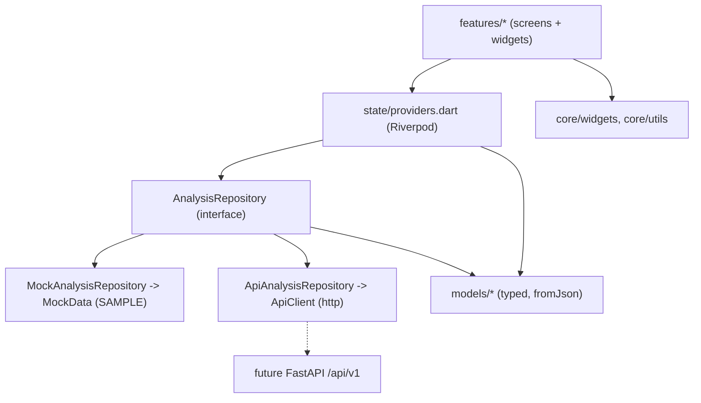

# Architecture

EARTH RISK CHAIN frontend (Flutter, Material 3, Riverpod, go_router).
Scope of this package: **frontend only**. No research pipeline, FastAPI
service, database, authentication or model training is included.

## Layers

Dependency rule: arrows only point downwards. `models` and `core` know nothing
about screens; screens never talk to HTTP; `ApiClient` never builds widgets.

| Layer | Folder | Responsibility |
|---|---|---|
| Screens / widgets | `lib/features/*` | Render state; no business rules, no HTTP. |
| Shared widgets | `lib/core/widgets` | Chips, panels, async/loading/error/unavailable views. |
| State | `lib/state/providers.dart` | Selection, derived async providers, DI of the repository. |
| Models | `lib/models` | Immutable typed data + `fromJson`. |
| Data | `lib/data` | Repository interface, mock + API implementations, `ApiClient`. |
| Config | `lib/core/constants/app_config.dart` | `--dart-define` driven: mock/API switch, API URL, tile provider. |

## Data flow

1. `analysisRepositoryProvider` returns the mock or API repository
   (`ERC_USE_MOCK`). It is the **only** place that decides.
2. `selectionProvider` holds *(area, hazard, zone)*, shared by all screens.
3. Derived `FutureProvider`s resolve the current analysis, layers,
   validation, explanation and impact for the selection. They return `null`
   (never fabricated data) when nothing exists.
4. Screens read these through `AsyncValueView` / `AnalysisGate`, which handle
   loading, error, "no analysis here" and "not available" uniformly.

## Navigation

`StatefulShellRoute.indexedStack` with five branches (Home, Explore, Risk,
Impact, Ask Earth). `AppShell` shows a bottom `NavigationBar` below 840 px and
a `NavigationRail` above (extended above 1200 px). `/about` is a root route
opened with `push`, so it has a real back button.

## Scientific-integrity rules encoded in the code

* Observed / derived / predicted / context are separate enums
  (`LayerClassification`, `ZoneBasis`) with distinct colours and chips.
* Change statistics are **pre-computed fields** (`ChangeStat`); the app never
  recomputes hazard values. Unknown values are `null` and render as
  "Not available".
* `PredictionInfo.isCalibrated` + `PredictionKind` stop a relative score being
  shown as a probability.
* Validation `notEvaluated` is rendered as "not a pass".
* Exposure copy always says "potentially exposed", never "damaged".
* Sample records carry `isSample` and show **SAMPLE DATA** chips/banners.

## Map

`flutter_map` with a configurable tile provider (`MapConfig`). Overlays come
from `MapLayer.features` (inline vector data). `buildOverlays`
(`features/explore/map_overlays.dart`) is a pure function that decides what to
draw:

* features with `observationId` (flood extent): Before -> before date,
  After -> after date, Change -> outline of the after date;
* features with `fromObservationId/toObservationId`: only in Change mode for
  the selected pair;
* everything else while its layer is visible.

Remote rasters (GeoTIFF/tiles/GeoJSON URLs) are **not rendered yet**; such
layers appear disabled with an explanation. See "Deferred" in the README.

If tiles fail to load (8 failed requests), a banner offers the offline
schematic basemap; overlays keep working.

## Testing

`test/` contains model-parsing, mock-repository, Ask-engine, API-client
(fake HTTP), overlay-logic and widget/navigation tests. Widget tests inject a
zero-latency repository and the schematic basemap, so they need no network.
